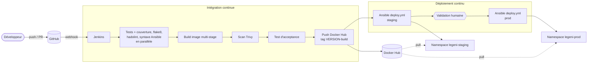

# Rapport final : chaîne CI/CD « du commit à la production » – Legeni WebApp

**Auteur(s) :** [nom(s) du binôme] – **Date :** [date de rendu] – **Dépôt :** [URL GitHub]

> Les passages entre crochets `[...]` (captures, résultats chiffrés, URL) sont à compléter **après**
> avoir exécuté chaque lot avec `docs/GUIDE_EXECUTION.md`. Ils ne contiennent volontairement aucun
> résultat inventé.

## 1. Contexte et objectif

LEGENI CONSULTING met en production à la main son application *Legeni WebApp* (Python/Flask + Redis) :
oublis, coupures, version déployée inconnue. L'objectif est une chaîne entièrement automatisée :
un `git push` déclenche les tests, l'analyse, l'empaquetage en image, la publication dans un
registre, le déploiement en *staging* sur Kubernetes, une **validation humaine unique**, puis le
déploiement en *production* sans interruption, avec retour arrière automatique en cas de problème.

## 2. Architecture

**Infrastructure (option A) :** une machine Ubuntu 24.04 hébergeant Jenkins (conteneur) et Minikube
(driver docker). Jenkins pilote le démon Docker de la machine par le socket (groupe `docker`, sans
`chmod 666`) et joint l'API Kubernetes parce qu'il est rattaché au réseau Docker `minikube`.
L'ensemble est installé par `ansible/provision.yml` : aucune installation manuelle.

## 3. Organisation du dépôt et choix techniques

| Élément | Choix | Justification |
|---|---|---|
| `Dockerfile` | multi-stage : `base` → `test` (flake8 + pytest) → `runtime` | les tests sont dans le build ; l'image finale ne contient ni outils de test ni dépendances de dev |
| Image finale | utilisateur `appuser` (UID 10001), `HEALTHCHECK`, `CMD` en forme exec, `APP_VERSION` par `--build-arg` | principe du moindre privilège ; arrêt propre (signaux reçus par gunicorn) ; version visible dans `/api/info` |
| Tag d'image | `<VERSION>-<n° de build>` (ex. `1.1.0-37`) | traçabilité : on retrouve la version et le build Jenkins ; jamais `latest` en production (`deploy.yml` le refuse) |
| `VERSION` | fichier à la racine, lu par le `Jenkinsfile` | un seul endroit à modifier pour une nouvelle version |
| Ansible | rôles `docker`, `minikube`, `jenkins` ; `deploy.yml` séparé | séparer l'infrastructure (rare) du déploiement applicatif (à chaque build) |
| Idempotence | `get_url`, `apt`, `docker_compose_v2`, tests d'état avant `minikube start` et `addons enable` | un second passage ne change rien (`changed=0`) |
| Secrets | `ansible/vars/vault.yml` chiffré (Ansible Vault) ; credentials Jenkins | aucun secret dans le dépôt ni dans le `Jenkinsfile` ; `.vault_pass` est ignoré par Git |
| Kubernetes | 2 namespaces, mêmes manifests Jinja2, paramètres dans `vars/staging.yml` et `vars/prod.yml` | seuls les réplicas, la couleur et le NodePort changent entre les environnements |
| Redis | StatefulSet + volume persistant (1 Gi), mot de passe dans un Secret | les données survivent à la recréation du pod |
| Application | Deployment avec `readinessProbe` (`/ready`), `livenessProbe` (`/health`), `requests`/`limits`, `RollingUpdate` avec `maxUnavailable: 0` | un nouveau pod n'entre dans le Service que s'il est prêt : aucune coupure pendant la mise à jour |

## 4. Le pipeline, stage par stage (`Jenkinsfile`)

| Stage | Rôle | Échoue si… |
|---|---|---|
| Init | lit `VERSION`, calcule le tag `VERSION-build` | `VERSION` absent |
| Qualité (parallèle) | **Tests + couverture** (JUnit, rapport de couverture), **flake8**, **hadolint**, **syntaxe Ansible** | un test échoue, couverture < 80 %, warning flake8, règle hadolint, erreur de syntaxe |
| Build image | étape `test` du Dockerfile puis image finale taguée | les tests dans l'image échouent |
| Scan Trivy | cherche les vulnérabilités CRITICAL corrigeables | au moins une trouvée (`--exit-code 1`) |
| Test d'acceptance | lance l'image dans un réseau jetable, vérifie `/health` et la version affichée | le conteneur ne répond pas ou renvoie une mauvaise version |
| Push registre | publie le tag sur Docker Hub (credential `registry-credentials`) | branche autre que `main` : stage ignoré |
| Déploiement staging | `ansible-playbook deploy.yml -e target_env=staging` | rolling update non terminé, smoke test KO → rollback automatique |
| Validation production | `input` : un humain clique sur **Déployer** | pas de validation en 30 minutes |
| Déploiement production | même playbook, `target_env=prod` | idem : rollback automatique puis build rouge |

Les branches `feature/*` et les pull requests exécutent seulement Qualité, Build, Scan et
Acceptance : les stages de push et de déploiement portent `when { branch 'main' }`. Une
notification (Discord, via un credential facultatif) est envoyée en cas d'échec et après chaque
mise en production.

**Le déploiement (`ansible/deploy.yml`)** applique le namespace, le Secret, Redis puis
l'application ; attend la fin du rolling update (`wait: true`) ; exécute un *smoke test* dans un pod
qui vérifie que `/api/info` renvoie bien la version déployée. Un bloc `rescue` appelle
`kubernetes.core.k8s_rollback` si une version précédente existe, puis fait échouer le playbook
pour que Jenkins affiche un build rouge.

## 5. Explication des fichiers (pour la question surprise)

| Fichier | Rôle |
|---|---|
| `app.py`, `tests/` | application Flask et ses 6 tests |
| `Dockerfile`, `.dockerignore` | image multi-stage ; le `.dockerignore` exclut `ansible/`, `docs/`, `.vault_pass`… du contexte de build |
| `VERSION` | numéro de version sémantique |
| `Jenkinsfile` | pipeline déclaratif (sections 4 ci-dessus) |
| `ansible/provision.yml` | installe Docker, Minikube, Jenkins ; relie Jenkins au réseau `minikube` |
| `ansible/roles/jenkins/` | Dockerfile et plugins de l'image Jenkins, `docker-compose.yml` généré (DNS, groupe du socket) |
| `ansible/roles/minikube/` | installe `minikube` et `kubectl`, démarre le cluster, active `metrics-server` et `ingress`, exporte `kubeconfig-jenkins.yml` |
| `ansible/deploy.yml` | déploiement Kubernetes avec smoke test et rollback |
| `ansible/templates/k8s/*.j2` | manifests (Namespace, Secret, Redis, application) paramétrés en Jinja2 |
| `ansible/vars/{staging,prod}.yml` | paramètres par environnement ; `vault.yml` : secrets chiffrés |
| `scripts/init-secrets.sh` | génère les mots de passe Redis et les chiffre avec Ansible Vault |
| `scripts/zero-downtime-check.sh` | compte les erreurs HTTP pendant une mise à jour (preuve du « zéro coupure ») |

## 6. Résultats et preuves

| Lot | Preuve attendue | Résultat |
|---|---|---|
| 0 – Git | `main` protégée, PR, tag `v<VERSION>` | [capture] |
| 1 – Docker | hadolint sans erreur, 0 CRITICAL corrigeable, tag `<VERSION>-<build>` | [sorties] |
| 2 – Ansible | `provision.yml` sur machine vierge, 2ᵉ passage `changed=0`, `vault.yml` chiffré | [PLAY RECAP] |
| 3 – Kubernetes | `kubectl get all,pvc` des 2 namespaces, rollback automatique | [sorties] |
| 4 – CI | Stage View, rapports JUnit / couverture / flake8, webhook | [captures] |
| 5 – CD | validation humaine, prod sans coupure (`zero-downtime-check.sh` : 0 erreur) | [captures] |

Vérifications déjà effectuées sur le code (hors cluster) : les 6 tests de l'application passent
avec 84 % de couverture, `flake8` ne signale rien, les deux playbooks passent
`ansible-playbook --syntax-check`, `yamllint` est propre et les manifests générés pour
*staging* et *prod* sont des YAML valides.

## 7. Difficultés rencontrées et solutions

| Difficulté | Cause | Solution retenue |
|---|---|---|
| Jenkins n'arrivait pas à cloner GitHub (`Could not resolve host`) | DNS du conteneur Docker sous WSL2 | `dns: [8.8.8.8, 1.1.1.1]` dans le `docker-compose.yml` de Jenkins, intégré au rôle Ansible `jenkins` |
| `Couldn't find any revision to build` | branche `master` demandée alors que le dépôt utilise `main` | corriger le *Branch Specifier* |
| Téléchargement de la base Trivy interrompu (`tls: bad record MAC`) | réseau instable | autre connexion ; paramètre `SCAN_SECURITE` du job pour dégrader explicitement (et le documenter) si la base est injoignable |
| `docker login` : `password is empty` | `read -s` collé avec la ligne suivante | lancer `read -s` seule sur sa ligne |
| Conflit de port 5000 | registre local déjà sur 5000 | changer le port hôte du conteneur de test |
| [difficulté propre au projet] | [cause] | [solution] |

## 8. Pistes d'amélioration

- **GitOps** (Argo CD) : Jenkins ne ferait plus que modifier le tag dans Git.
- **Ingress** `staging.legeni.local` / `legeni.local` avec TLS, à la place des NodePort.
- **HPA** sur la production et démonstration de montée en charge.
- **Supervision** : Prometheus et Grafana (`kube-prometheus-stack`).
- Tag Git `v<VERSION>` posé automatiquement par le pipeline après la production.
- Scan Trivy avec base de vulnérabilités mise en cache dans un miroir interne.
